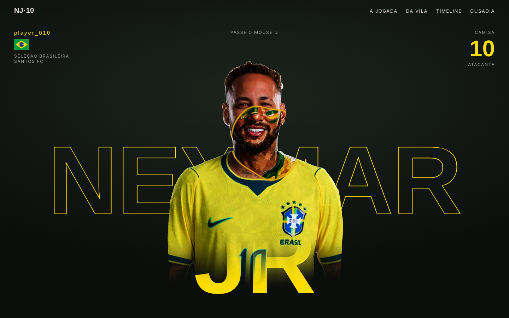
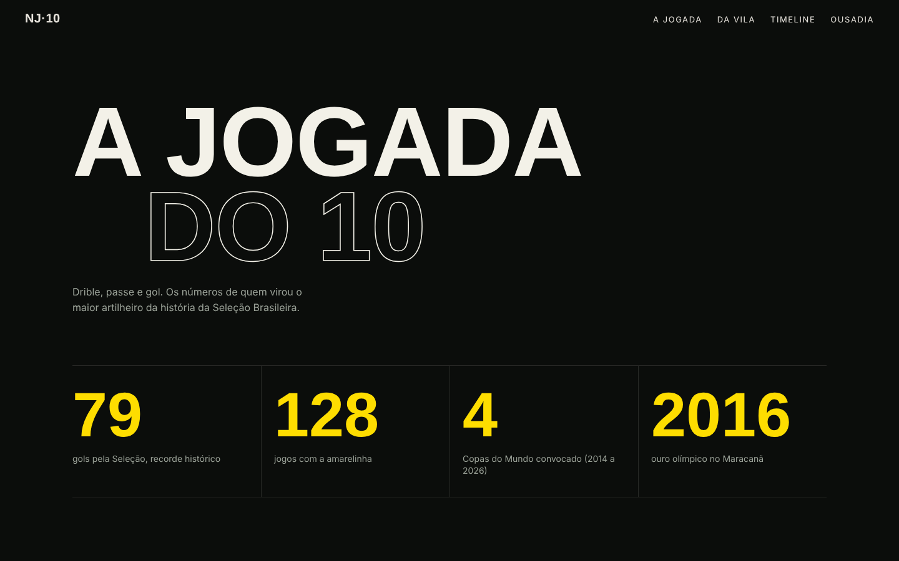
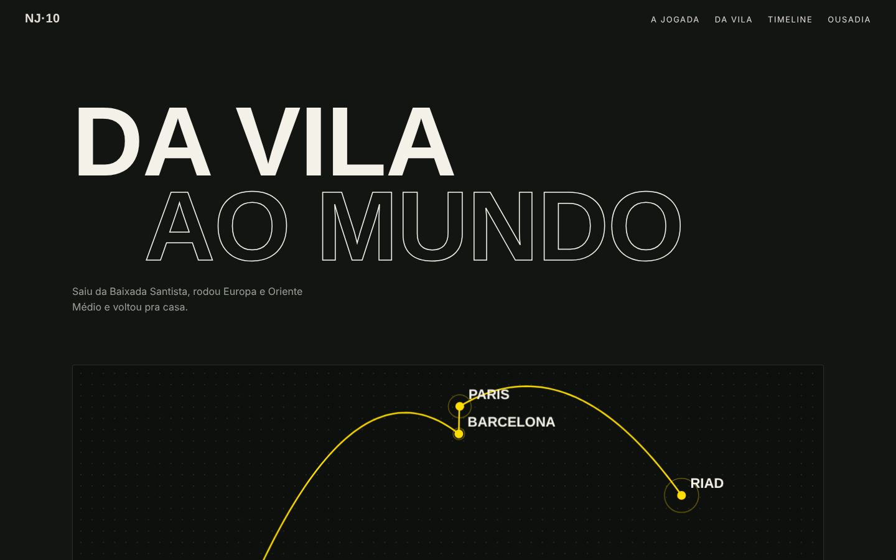
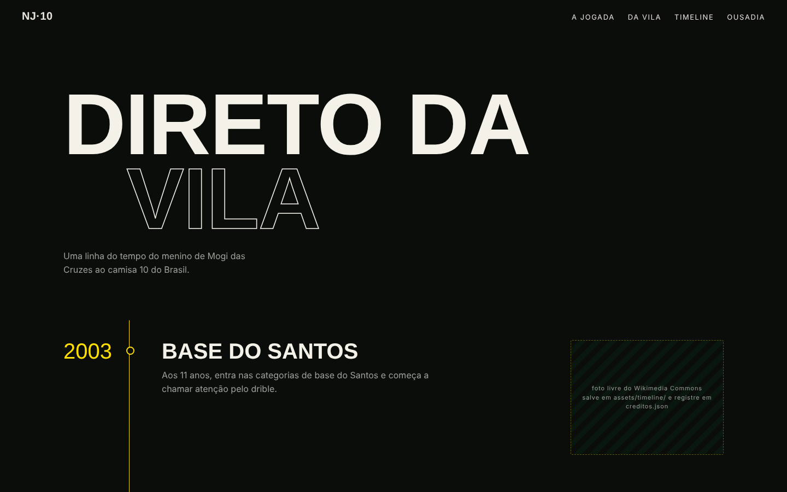
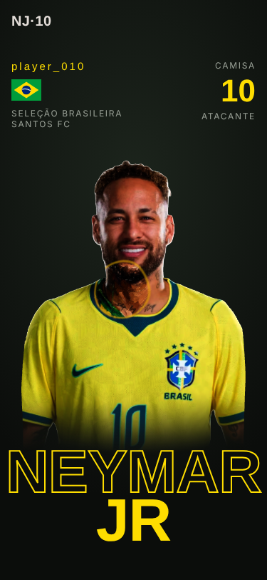

# Neymar Jr · Fan Site

Fan site não oficial sobre a trajetória do Neymar Jr, da Vila Belmiro à Seleção. Retrato 3D interativo em Three.js, scroll suave com Lenis e visual nas cores do Brasil.



## Seções

| A jogada do 10 | Da Vila ao mundo |
|---|---|
|  |  |

| Direto da Vila | Versão mobile |
|---|---|
|  |  |

## Como funciona o hero

- A foto vira um plano 3D com 55 mil vértices, deslocados por um mapa de profundidade gerado a partir do recorte da silhueta (`rembg` + transformada de distância).
- Um mapa de normais derivado da profundidade faz a luz acompanhar o mouse.
- Dentro do círculo do mouse aparece uma pintura a óleo original (máscara de carnaval e pintura de torcida), alinhada à foto pelos olhos e pela boca. Fora da pintura, o shader desenha uma retícula amarela e verde.
- No celular o círculo se move sozinho.

## Tecnologias

- HTML, CSS e JavaScript puro, sem build
- [Three.js](https://threejs.org) 0.160 com shaders GLSL próprios
- [Lenis](https://lenis.darkroom.engineering) para o scroll suave
- Fontes Oswald e Space Grotesk
- Python (Pillow, NumPy, SciPy, rembg) para gerar os mapas de profundidade e normais

## Rodar localmente

As texturas precisam de um servidor local, então abrir o `index.html` direto com dois cliques não funciona.

```bash
git clone https://github.com/Dv-TiagoCarvalho/Neymar--site3d.git
cd Neymar--site3d
python3 -m http.server 8000
```

Depois acesse http://localhost:8000.

## Linha do tempo com fotos

Salve fotos com licença livre do Wikimedia Commons em `assets/timeline/` e registre cada uma em `creditos.json`:

```json
[{"ano": 2016, "arquivo": "assets/timeline/2016.jpg", "autor": "Nome do autor", "licenca": "CC BY-SA 4.0", "url": "https://commons.wikimedia.org/..."}]
```

A foto aparece no ano certo e o crédito vai para o rodapé.

## Aviso

Projeto de fã, sem fins comerciais e sem vínculo com o atleta, a CBF ou o Santos FC. A pintura do hero foi gerada com IA no Higgsfield.

---

Feito por [Tiago Carvalho](https://github.com/Dv-TiagoCarvalho)
